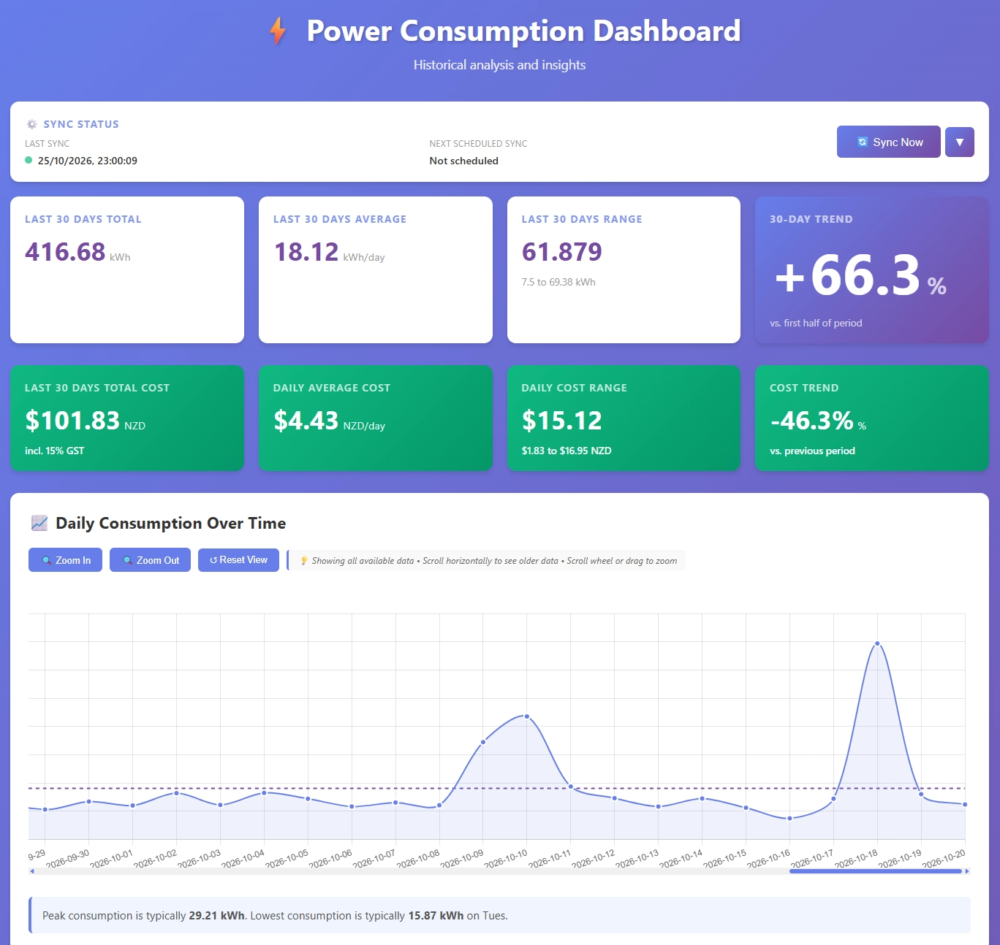
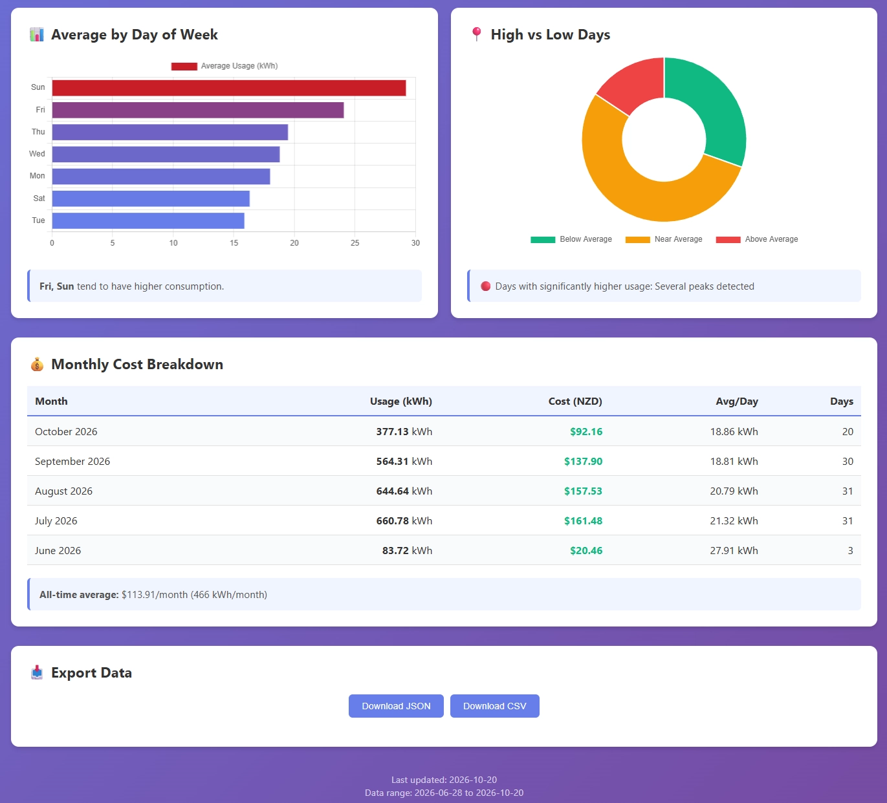

# ⚡ Ecotricity Consumption Tracker

Fetches your power consumption from the Ecotricity portal, stores it in SQLite, and serves an interactive dashboard.




## Features

- Automated login and daily data fetch from the Ecotricity portal
- SQLite storage with historical backfill for late-arriving data
- Web dashboard: consumption trends, day-of-week breakdown, high/low distribution, cost analysis (incl. 15% GST), JSON/CSV export
- Background scheduler (daily fetch + weekly backfill)
- CLI with formatted output, same data pipeline
- Docker and docker-compose support with health check

## Requirements

- Python 3.15+
- Dependencies: `requests`, `python-dotenv`, `rich`, `flask`, `apscheduler`, `tzdata`

```bash
pip install -r requirements.txt
```

## Quick Start

```bash
git clone <repository-url>
cd ecotricity-fetchusage
pip install -r requirements.txt

# Credentials
echo "ECOTRICITY_LOGIN=your_account_number" >> .env
echo "ECOTRICITY_PASSWORD=your_password" >> .env

# Backfill history, fetch now, run scheduler and dashboard
python run.py all
```

Dashboard: <http://127.0.0.1:5000>

### Credentials

Credentials can come from (in order of convenience):

1. `.env` file in the project root
2. Environment variables `ECOTRICITY_LOGIN` / `ECOTRICITY_PASSWORD`
3. Interactive prompt when running `python ecotricity.py`

## Commands

| Command | Purpose |
|---|---|
| `python run.py all` | Backfill, fetch, start scheduler and web UI |
| `python run.py fetch [--dates "last 30 days"]` | One-off fetch (default: last 7 days) |
| `python run.py scheduler [--hour 22 --minute 30]` | Scheduler only (default: 23:00 daily) |
| `python run.py backfill [--start YYYY-MM-DD --end YYYY-MM-DD] [--max 10]` | Fill gaps (default: last 90 days) |
| `python run.py web [--host 0.0.0.0] [--port 8000] [--debug]` | Dashboard only |
| `python ecotricity.py [--dates "last month"]` | Original CLI |

Supported date presets: `last 2 days`, `last 7 days` (default), `last 30 days`, `last month`, `last 3 months`.

## Dashboard

Features: summary statistics, cost analysis (15% GST), time-series/trend chart, day-of-week chart, high/low distribution, insights, JSON/CSV export.

API endpoints:

| Endpoint | Description |
|---|---|
| `GET /` | Dashboard |
| `GET /health` | Health check |
| `GET /api/data` | Consumption data (last 30 days) |
| `GET /api/statistics` | Statistical summary |
| `GET /api/summary` | 30-day and all-time summary |
| `GET /api/daily-breakdown` | Average by day of week |
| `GET /api/trends` | Trend calculations |
| `GET /api/costs/statistics` | Cost statistics and trends |
| `GET /api/costs/daily` | Daily costs (last 30 days) |
| `GET /api/costs/monthly` | Monthly cost breakdown |
| `GET /api/sync/info` | Last/next sync information |
| `POST /api/sync/trigger` | Trigger a fetch |
| `GET /api/export/json` | Export all data as JSON |
| `GET /api/export/csv` | Export all data as CSV |

## Configuration

Optional `config.json` (auto-created) overrides defaults:

```json
{
  "scheduler": { "enabled": true, "hour": 23, "minute": 0 },
  "web_ui": { "host": "127.0.0.1", "port": 5000, "debug": false }
}
```

Cost constants live in `database.py`:

```python
COST_PER_KWH = 0.2125  # before GST
GST_RATE = 0.15
```

### Environment Variables

| Variable | Default | Description |
|---|---|---|
| `ECOTRICITY_LOGIN` | — | Account number (required) |
| `ECOTRICITY_PASSWORD` | — | Password (required) |
| `SCHEDULER_HOUR` | `23` | Daily fetch hour (0–23) |
| `SCHEDULER_MINUTE` | `0` | Daily fetch minute (0–59) |
| `FLASK_HOST` | `127.0.0.1` | Web host (`0.0.0.0` in Docker) |
| `FLASK_PORT` | `5000` | Web port |
| `ECOTRICITY_TIMEZONE` | `Pacific/Auckland` | Timezone used to build API date ranges |
| `ECOTRICITY_TIMEOUT` | `30` | Per-request timeout (seconds) |
| `ECOTRICITY_MAX_ATTEMPTS` | `4` | Attempts per request (1 = no retries) |
| `ECOTRICITY_BACKOFF_BASE` | `2.0` | Exponential backoff base (seconds) |
| `ECOTRICITY_BACKOFF_CAP` | `30` | Maximum backoff delay (seconds) |
| `ECOTRICITY_BATCH_DELAY` | `1.5` | Pause between backfill requests (seconds) |

## Database

SQLite at `data/consumption.db`:

- `consumption`: `id`, `date` (unique), `weekday`, `value` (kWh), `fetched_at`
- `fetch_attempts`: `id`, `date_requested`, `attempt_date`, `success`, `error_message`

```python
from database import get_last_fetch_date, get_data_range

print(get_last_fetch_date())
print(get_data_range())
```

## Data Collection Strategy

- **Daily fetch (23:00)** retrieves the last 7 days to absorb API delays.
- **Backfill on scheduler start** fills gaps from the last 90 days.
- **Weekly backfill (Mondays 02:00)** catches data published late or corrected by the portal.
- **Manual backfill**: `python run.py backfill --start 2026-01-01 --end 2026-06-30`.

The client retries `429`/`5xx` with exponential backoff and jitter (honouring `Retry-After`), re-authenticates once per fetch if the session goes stale, and treats `503 "No metering data available"` as a business response rather than an outage.

## Docker

```bash
cat > .env << EOF
ECOTRICITY_LOGIN=your_account_number
ECOTRICITY_PASSWORD=your_password
EOF

docker compose up -d          # build + start
docker compose logs -f        # follow logs
curl http://localhost:5000/health
docker compose down           # stop (data kept)
```

Manual:

```bash
docker build -t ecotricity .
docker run -d --name ecotricity --restart unless-stopped \
  -p 5000:5000 \
  -e ECOTRICITY_LOGIN="your_account" \
  -e ECOTRICITY_PASSWORD="your_password" \
  -v ecotricity_data:/app/data \
  ecotricity
```

The image runs as non-root `appuser` (UID 1000), persists `/app/data` in a named volume, and includes a `/health` check. `portainer-stack.yml` is provided for Portainer deployments.

Images are built and published to GHCR by `.github/workflows/docker-build.yml` on pushes to `main`/`master` and on `v*` tags:

```bash
docker pull ghcr.io/YOUR_USERNAME/ecotricity-fetchusage:latest
```

Run commands inside a container:

```bash
docker compose exec ecotricity python run.py fetch --dates "last month"
docker compose exec ecotricity python run.py backfill
```

Backup the database:

```bash
docker cp ecotricity-fetchusage:/app/data/consumption.db ./consumption.db.backup
```

## Troubleshooting

- **Credentials not found**: set `ECOTRICITY_LOGIN`/`ECOTRICITY_PASSWORD` or create `.env`.
- **Login failed**: verify account number/password and that the account is active.
- **HTTP 503 "No metering data available"**: no data for that range — try another range. This is not retried by design.
- **Repeated 429/5xx**: portal/WAF may block the container's source IP; check logs, try another host/VPN.
- **Wrong date ranges in Docker**: containers run in UTC; dates are rendered in `Pacific/Auckland` regardless, override with `ECOTRICITY_TIMEZONE`.
- **Dashboard won't start**: port 5000 in use (`python run.py web --port 8000`) or dependencies missing.
- **No data in dashboard**: run `python run.py fetch`, then check logs for fetch errors.
- **Permission errors in Docker**: files under `/app/data` must be writable by UID 1000.

Scheduler log markers: `Starting scheduled fetch...`, `✓ Fetched and stored X records`, `✗ Scheduled fetch failed`.

## Project Structure

```
ecotricity-fetchusage/
├── ecotricity.py          # Original CLI script
├── app.py                 # Flask web application
├── scheduler.py           # Background task scheduler
├── database.py            # Database and cost calculations
├── config.py              # Configuration management
├── run.py                 # Main entry point with subcommands
├── data/consumption.db    # SQLite database (created on first run)
├── templates/index.html   # Dashboard HTML/CSS/JS
├── docs/images/           # README screenshots
├── Dockerfile
├── docker-compose.yml
├── portainer-stack.yml
├── requirements.txt
└── LICENSE
```

## API Details

- **Portal**: <https://portal.ecotricity.co.nz/powercommerce/eco/fo/portal>
- **Data endpoint**: `/analysis/valueRequest`
- **dateType**: `DAY` (single day, 30-minute granularity), `WEEK` (1–7 days), `MONTH` (any range) — `WEEK`/`MONTH` return daily values
- **Metric**: `POWER_ACTIVE_PURCHASE_CONSUMPTION`
- **Timezone**: `Pacific/Auckland`

## License

MIT License

Copyright (c) 2026 Altan

Permission is hereby granted, free of charge, to any person obtaining a copy
of this software and associated documentation files (the "Software"), to deal
in the Software without restriction, including without limitation the rights
to use, copy, modify, merge, publish, distribute, sublicense, and/or sell
copies of the Software, and to permit persons to whom the Software is
furnished to do so, subject to the following conditions:

The above copyright notice and this permission notice shall be included in all
copies or substantial portions of the Software.

THE SOFTWARE IS PROVIDED "AS IS", WITHOUT WARRANTY OF ANY KIND, EXPRESS OR
IMPLIED, INCLUDING BUT NOT LIMITED TO THE WARRANTIES OF MERCHANTABILITY,
FITNESS FOR A PARTICULAR PURPOSE AND NONINFRINGEMENT. IN NO EVENT SHALL THE
AUTHORS OR COPYRIGHT HOLDERS BE LIABLE FOR ANY CLAIM, DAMAGES OR OTHER
LIABILITY, WHETHER IN AN ACTION OF CONTRACT, TORT OR OTHERWISE, ARISING FROM,
OUT OF OR IN CONNECTION WITH THE SOFTWARE OR THE USE OR OTHER DEALINGS IN THE
SOFTWARE.
